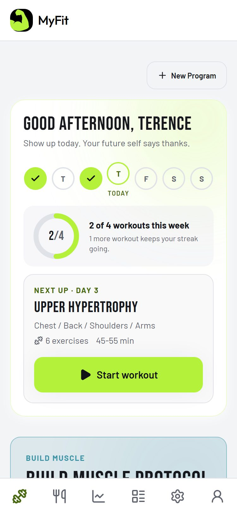
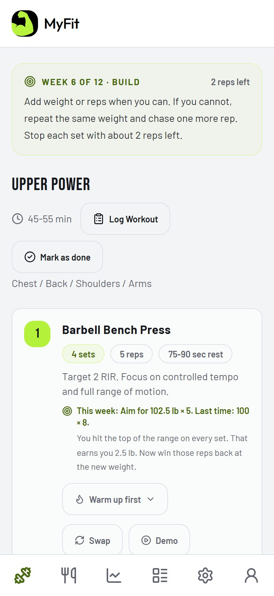
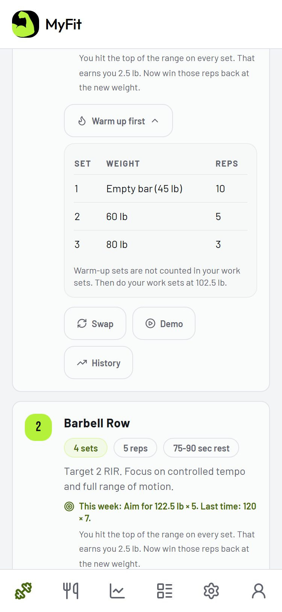
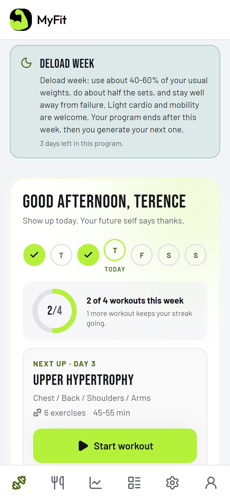
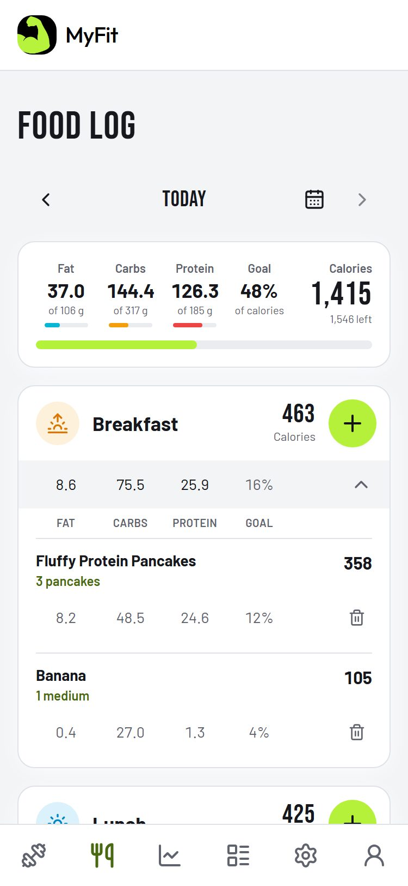
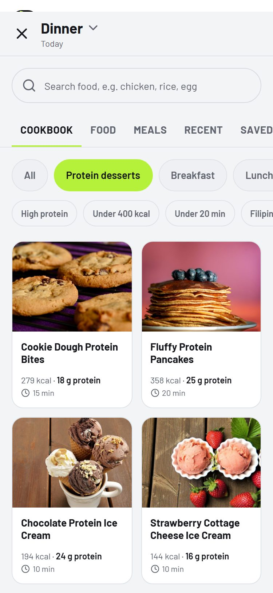
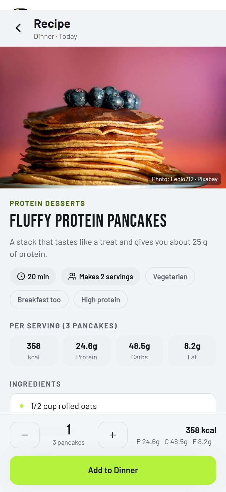
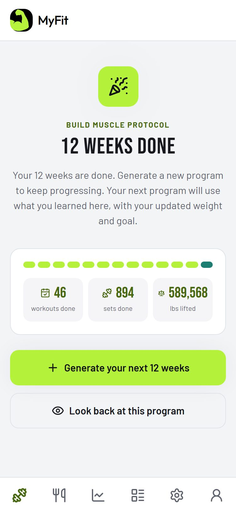

# MyFit: Workout & Calorie Tracker

A workout and nutrition app that builds a **12-week program** around your goal, equipment and recovery, tells you exactly what to lift each week, and tracks your food with a built-in **cookbook of healthy recipes**. Web app plus a native Android app, with subscriptions through Google Play.

**Stack:** React 19 · TypeScript · Vite · Tailwind CSS · Framer Motion · Supabase (Postgres, Auth, Row Level Security, Edge Functions) · Capacitor 8 (Android) · RevenueCat / Google Play Billing · Vercel

**Live app:** https://getmyfit.vercel.app (sign up free: the first workout of every program is free)


---

## Screenshots

<table>
  <tr>
    <td></td>
    <td></td>
    <td></td>
    <td></td>
  </tr>
  <tr>
    <td align="center"><sub>Today: your week at a glance</sub></td>
    <td align="center"><sub>This week's target and what to lift</sub></td>
    <td align="center"><sub>Warm-up sets and coaching lines</sub></td>
    <td align="center"><sub>Deload week</sub></td>
  </tr>
  <tr>
    <td></td>
    <td></td>
    <td></td>
    <td></td>
  </tr>
  <tr>
    <td align="center"><sub>Food log, aligned macro columns</sub></td>
    <td align="center"><sub>Cookbook: protein desserts</sub></td>
    <td align="center"><sub>Recipe with steps, one tap to log</sub></td>
    <td align="center"><sub>12 weeks done: next program</sub></td>
  </tr>
</table>

---

## Features

| | |
|---|---|
| **Program builder** | A 13-step guided wizard (goal, experience, equipment, days per week, injuries, focus areas such as glutes, recovery and sleep). It builds a full program for a full gym, dumbbells only, resistance bands, bodyweight at home, yoga or Pilates. |
| **12-week lifecycle** | Every program is built for 12 weeks: Base, Build, Push, a test week, then a **deload week** (about half the sets, about half the weight). After that the program is finished, stays viewable, and the next one is generated. |
| **A new program each time** | A year is four blocks (Foundation, Strength, Size, Peak). The main lifts stay so strength carries over, the accessories rotate, and the rep ranges follow the block, so a new program is never a copy of the last. |
| **Week-by-week weights** | From what you logged last time, each exercise says what to aim for: add 2.5 lb at the top of the rep range and start the reps again, otherwise one more rep. It handles misses, stalls (three workouts with no better set), long breaks and the deload week, with a short coaching line for each case. |
| **Warm-up sets** | Heavy opening lifts get a warm-up ramp worked out from the weight you are about to lift. Warm-up sets are shown but never counted as work. |
| **Food log** | Day summary, meals with aligned macro columns, recent searches, and a full-screen search over a built-in food list (including 170+ Filipino foods) plus the USDA FoodData Central and Open Food Facts databases through a server-side function. |
| **Cookbook** | 43 healthy recipes with a photo, steps and macros: protein desserts (cookie dough bites, pancakes, ice cream), breakfast, lunch and dinner, snacks. The numbers are **calculated from the ingredients**, so they always add up. One tap adds a recipe to the food log. |
| **Nutrition targets** | Calories from the Mifflin-St Jeor equation and activity level; a 40/30/30 split with protein held between 1.6 and 2.4 g per kg of body weight. |
| **Reminders and widget** | Local notifications for workout days and rest timers, and an Android home-screen widget with the next workout and the week's progress. |
| **Subscriptions** | Google Play Billing through RevenueCat, 7-day free trial, prices shown in the buyer's own currency, and a webhook Edge Function that keeps the subscription state in Postgres in sync. |
| **Admin dashboard** | Members, programs, discount codes and activity, locked behind a role that cannot be self-assigned. |
| **Privacy** | Row Level Security on every table, in-app account deletion (with a public deletion page, as Google Play requires), and subscription columns that users cannot write to. |
| **Resilient by design** | A global error screen instead of a blank page, retry on failed loads, and every saved program is normalised on load so programs from older versions never crash newer screens. |

## Architecture

```
React + TypeScript (Vite) ── web (Vercel) and Android app (Capacitor)
   │
   ├─ rules-based program generator (client side, deterministic, no AI cost)
   │     templates per level and days ─ equipment filters ─ injury filters
   │     ─ focus-area rules ─ 12-week block + deload ─ weekly progression
   │
   ├─ api.ts ── one interface, two backends
   │     mockApi (browser storage, demo mode)   supabaseApi (production)
   │
   └─ Supabase ── Postgres + Row Level Security
         Auth (email, Google)    Edge Functions (Deno)
         food-search · revenuecat-webhook · delete-account · admin-delete-member
```

**Why a rules-based generator instead of an AI model?** Programs are deterministic, free to produce, work offline, never invent an unsafe exercise, and can be unit-tested exhaustively. The "coach" voice comes from rules over the person's own logged numbers.

## Testing

22 test scripts run with one command (`npm test`). Examples of what they prove:

- **Programs:** every generated program follows its reference template; focus areas land on the right half of the body (1,536 combinations); a new block keeps the main lifts and changes the accessories across 108 setups.
- **Progression:** the 12-week calendar moves through training, test and deload on exactly the right days; the weight to aim for is right after a good week, a miss, a stall and a long break.
- **Nutrition:** 4,800 body and activity combinations give a valid macro split.
- **Cookbook:** all 43 recipes are complete, and their calories and macros match their ingredients.
- **Resilience:** programs saved by older versions, with missing fields, are filled in so nothing crashes.

## Highlights

- Designing the **12-week lifecycle** end to end: state worked out from a single start date, so there is no extra stored state to get out of step.
- Turning coaching rules (double progression, stalls, deloads) into small **pure functions that are fully tested**.
- Making an app that is safe to ship: access rules in the database, server-side secrets, store-compliant billing and account deletion.
- Debugging a production crash on a real phone by adding an error screen, reading the minified stack trace, and tracing it to data saved by an older version.

## Project layout

```
src/pages            screens (Home, Food, Progress, Account, Admin, ...)
src/components       UI by area (program, food, intake, admin, layout)
src/lib              logic: program generator, 12-week block, weekly progression, nutrition, cookbook
src/lib/backend      api.ts facade, mockApi (demo) and supabaseApi (production)
supabase/            migrations (schema and Row Level Security) and Edge Functions
scripts/             the test scripts (npm test)
android/  ios/       Capacitor native projects
```

---

# Setup and deployment

## Run it locally (demo mode, no setup)

```bash
npm install
npm run dev
```

Demo admin account: `admin@myfit.app` / `admin123`. Data lives in your browser's `localStorage` — nothing is shared across devices, and no real payment is ever collected. This mode requires zero configuration and is what runs when no Supabase env vars are set.

## Going to production

The app automatically switches from the mock backend to a real one the moment `VITE_SUPABASE_URL` and `VITE_SUPABASE_ANON_KEY` are set (see `src/lib/backend/api.ts` — it picks `mockApi.ts` or `supabaseApi.ts` based on that). Here's the full checklist to go live for real:

### 1. Supabase (database + auth)

1. Create a project at [supabase.com](https://supabase.com).
2. SQL Editor → run `supabase/migrations/0001_init.sql`, then `supabase/migrations/0002_billing_and_progress.sql`, in that order.
3. Project Settings → API → copy the **Project URL** and **anon/public key** into `.env.local` (copy `.env.example` first):
   ```
   VITE_SUPABASE_URL=https://xxxx.supabase.co
   VITE_SUPABASE_ANON_KEY=eyJ...
   ```
4. Authentication → Providers → Email should already be on. Decide whether to require email confirmation (Authentication → Settings) — the app handles both (shows a "check your email" screen if confirmation is required).
5. Restart `npm run dev` — the app now talks to real Supabase: real accounts, real database, admin dashboard sees every real user.

### 2. Payments

Subscriptions are sold through **Google Play Billing**, run by RevenueCat (see the next section). There is no separate card-payment provider on the web: people subscribe inside the Android app.

### 3. Play Store (native Android app + Google Play Billing)

Google requires in-app digital subscriptions to go through Google Play Billing. The app uses RevenueCat, which wraps Play Billing, and activates Pro through the `revenuecat-webhook` edge function.

1. **Google Play Console** — [play.google.com/console](https://play.google.com/console), $25 one-time developer fee. Create the app (package name must match `capacitor.config.ts`'s `appId`: `com.myfit.app`, or change both to match). Under Monetize → Products → Subscriptions, create two products with these exact IDs: `pro_monthly` (₱199/mo) and `pro_yearly` (₱1,790/yr), each with a 7-day free-trial offer.
2. **RevenueCat** — [revenuecat.com](https://revenuecat.com), free up to $2.5k/mo tracked revenue. Create a project, add a Google Play app, and link it to your Play Console app (RevenueCat's setup wizard walks you through creating a Google service account key for this — needed so RevenueCat can verify purchases server-side).
   - Products: add `pro_monthly` and `pro_yearly` (matching Play Console).
   - Entitlements: create one called `pro`, attach both products to it.
   - Offerings: create a default Offering with a Monthly and an Annual package pointing at those products.
   - Copy the **Google Play public API key** (Project Settings → API Keys) into `.env.local`:
     ```
     VITE_REVENUECAT_ANDROID_KEY=goog_...
     ```
3. **Sync the webhook** so purchases update Supabase: deploy `revenuecat-webhook`, set its secret, then add the URL in RevenueCat (Project Settings → Integrations → Webhooks):
   ```bash
   supabase functions deploy revenuecat-webhook --no-verify-jwt
   supabase secrets set REVENUECAT_WEBHOOK_SECRET=<any long random string> \
     SUPABASE_URL=https://xxxx.supabase.co \
     SUPABASE_SERVICE_ROLE_KEY=eyJ...
   ```
   Paste the same random string into RevenueCat's webhook "Authorization header value" field.
4. **Build the Android app** (needs Android Studio + JDK installed locally — this part can't be done from this environment):
   ```bash
   npm run android:open   # builds the web app, syncs it into android/, opens Android Studio
   ```
   From Android Studio you can run it on an emulator/device, and eventually build a signed `.aab` to upload to Play Console.
5. Test purchases using a Play Console **license tester** account (Play Console → Setup → License testing) before going live — real Google accounts get charged real money otherwise.

### 4. (Optional) Real LLM instead of the deterministic generator

Program generation (`src/lib/backend/programGenerator.ts`) is a fast, free, deterministic rules engine by default — it doesn't call any AI API. If you want an actual LLM writing the programs:

1. Deploy `supabase/functions/generate-program/index.ts` and set an `ANTHROPIC_API_KEY` secret on it.
2. Point `programs.generate()` in `supabaseApi.ts` at that function instead of the local `generateProgram()` call.

### 5. Legal pages

`/terms`, `/privacy`, and `/refund-policy` are already built and linked from the footer — they're a starting template, not legal advice. **Have a Philippines-licensed lawyer review them** before relying on them commercially, especially the Data Privacy Act (RA 10173) section and Stripe's own requirements.

### 6. Hosting

Any static host works (`npm run build` → deploy `dist/`): Vercel, Netlify, Cloudflare Pages, etc. Set the two `VITE_SUPABASE_*` env vars in that host's dashboard too — they're baked in at build time.

## Architecture notes

- `src/lib/backend/api.ts` is a facade — every page imports from here, never from `mockApi.ts` / `supabaseApi.ts` directly, so the whole app is backend-agnostic.
- `src/lib/backend/types.ts` defines the shared interface both implementations must satisfy — if you extend the backend, add the method there first so TypeScript catches any drift between mock and real.
- The TDEE/recovery math (`src/lib/tdee.ts`) is deterministic and client-side either way — it doesn't change when you swap backends.

---

## License

All rights reserved. The code is public so it can be read and reviewed; it may not be copied, sold or used to build another product without permission. See [LICENSE](LICENSE). Recipe photos are from [Pixabay](https://pixabay.com) and credited inside the app.
